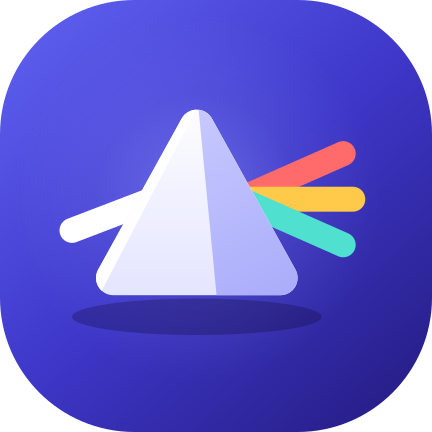

<p align="center"></p>

# Prism

Prism is the owner's companion for david-cluster-1: a macOS menu-bar app and
an Android app that show the cluster's and the machines' alerts, start T3
coding agents to fix them, and answer what agents ask, plus the
workers behind them and the `prism` CLI machines report with.

| Path | What |
|---|---|
| `cli/` | The `prism` CLI (Rust): `prism run`/`report`/`ping` on every fleet host, `register-t3*` on every T3 host, `prism pair`/`machines` in a worker pod (`docs/worker.md`); `packages.<system>.prism` |
| `worker/` | The prism worker (Rust): Prism's server, a StatefulSet in the cluster serving `prism.quickme.at`, each pod a replica of Prism's Rocky database (`docs/worker.md`). `worker/Dockerfile` builds the image `ghcr.io/bierdav/prism-worker`, which also carries `prism` |
| `rocky-prism/`, `rocky-prism-ffi/`, `uniffi-bindgen/` | Prism's Rocky schema and client API, shared by the worker and the apps, and the apps' bindings to it |
| `deploy/` | The Kubernetes manifests Argo CD deploys (`apps/prism.yaml` in selfhosted-platform); CI pins the image here |
| `docs/prism-api.md` | The contract between the workers and the apps |
| `docs/placement.md` | Placement profiles: how Prism schedules models across T3 hosts and the phone API |
| `macos/` | **Prism for macOS**: a menu-bar popout with the server's alerts and agents, the hosts' performance and the approvals, the approval dialog, Touch ID and the Secure Enclave key; `install.sh` builds it |
| `shared/` | The code both apps share: Kotlin Multiplatform without Gradle, compiled into the Android app and linked into the Mac app as `PrismShared.framework` (Kotlin/Native, built by Nix); `shared/README.md` |
| `android/` | **Prism for Android**: the same, a StrongBox key behind a fingerprint; Kotlin and Jetpack Compose (Material 3 Expressive), built by Nix without Gradle |
| `android/shizuku/` | Shell access (uid 2000) on Android: Prism's own shell server, started by the cluster over adb, which also serves apps built on Shizuku's API (v13) as Shizuku would, with Prism asking the owner per app; the native starter and the contract with the cluster; derived from Shizuku (Apache-2.0) and Shizuku-API (MIT), notices in `android/shizuku/NOTICE`; `android/shizuku/README.md` |
| `android/netbird/` | NetBird's client library (github.com/netbirdio/netbird v0.83.1, `client/android`, BSD-3-Clause; notice in `android/netbird/NOTICE`, also in the APK), built with gobind and the NDK; the app joins the owner's NetBird network itself (`netbird/NetbirdVpn.kt`, a VpnService), enrolled once by the setting `netbird_setup_key`, which only enrollment over USB writes; it routes the NetBird peers, the resources (networks and domains) switched on on the Phone tab's "Resources" page (none by default), and everything through an exit node if one is picked there (`Client.networks()` / `selectRoute` / `deselectRoute`, kept in the app's preferences and applied again on every connect and route change) |
| `android/publish.py` | Signs the APK and uploads it and the phone's settings to the Prism workers, where the phone updates itself from (`packages.<system>.android-publish`; fleet runs it on david-mm) |
| `android/enroll.py` | Enrolls the phone over USB: installs Prism, makes it the Device Owner, writes its settings (`packages.<system>.phone-enroll`; fleet's `prism-phone-enroll` on david-mb; `docs/android-enrollment.md`) |
| `flake.nix` | `packages.<system>.prism` (the CLI, also `default`), `android-apk`, `android-apk-dpcdebug`, `android-previews`, `android-publish`, `phone-enroll`, `netbird-android`, `prism-shared-framework` and `prism-macos-app` (Apple Silicon); `lib.macosApp`; checks |

Both apps have a generic **approval** queue (`shared/`, `Approvals.kt`):
something asks the owner to approve, the app shows what is asked, and Approve
signs it with the device key (Touch ID or a fingerprint; SSHSIG, namespace
`approval@prism.quickme.at`). T3 approvals appear here when Prism has a scoped client session on that host.

When a device can't reach the workers, it sends its fixes, agents,
follow-ups, stops and answers to T3 itself, over NetBird, with T3 sessions
each fleet T3 host registers for it; nobody pairs by hand
(`docs/direct-fix.md`).

[fleet](https://gitea.quickme.at/david-cluster-1/fleet) deploys the CLI
(trait `prism-client`) and the Mac app (trait `prism`) from this repository,
pinned by commit (`prism` in its `flake.nix`). It also publishes the Android
app to the Prism workers (`android-publish`) and enrolls the phone (`phone-enroll`).
When `main` changes `cli/`, `macos/`, `shared/`, `android/`, the cargo
workspace or `flake.*`, the
`fleet-prism` CronJob in `selfhosted-platform` bumps that pin automatically
every five minutes, and every host then deploys `main` on its own.

## The apps

### Prism for macOS

The menu-bar popout's tabs:

- **Alerts**: the server's open alerts and machine events, grouped by
  category with their severity; per alert the agents it started (Open in T3)
  and the quick actions fix and a free-text instruction;
  below them "Do…" starts an agent for any task, on the cluster or a machine
  picked from the server's machines. The model and reasoning level for new
  agents are picked there too. The menu-bar glyph shows the number of open
  critical alerts, and new alerts and agents' questions come as
  notifications.
- **Machines**: every fleet host's and cluster node's CPU, memory, disk,
  network, load, uptime and battery, with the last two hours of CPU and
  memory (`GET /v1/machines/metrics`); click a host for its filesystems.
- **Approvals**: what waits for the owner's decision (a click opens it), the
  last decisions and this Mac's public key.
- **Wi-Fi** (the Wi-Fi icon): the reliable networks the Mac leaves the
  phone's hotspot for, and the phone's hotspot it joins after asking the
  phone; add the current, a nearby, a known or a typed network, or remove one
  (docs/hotspot.md).

Approvals are generic (`shared/`: `Approvals.kt`): something asks, with a
title, its source, a summary, details and optionally the T3 thread that asks,
and the dialog shows it until it expires. Approve takes one touch of Touch ID
and signs the approval with the Secure Enclave key (SSHSIG, namespace
`approval@prism.quickme.at`); Deny is Esc. T3 approvals offer one-time or session approval where the provider supports it.

The Mac's Prism data is its own replica of Prism's Rocky database
(`~/Library/Application Support/Prism/rocky`), enrolled from the
provisioning fleet writes for it (`rocky.provisioningFile` and `rocky.peers`
in the app's config) and synced with the workers on its own; there is no
token and no sign-in. Push is the relay's `prism-events` topic. The key and
the approvals' history live in `~/Library/Application Support/Prism`.

The Mac uses its replica as the phone does, through `shared/`:
`PrismReplica.client` answers every API call from the replica,
`RelayStream` reads the push, and the views show shared/'s objects
(`Api.kt`) as they come. The Swift code (`macos/Alerts.swift`) keeps only
what is the Mac's own: the popout, the notifications and the Secure Enclave
key.

On a Mac, `prism pubkey | self-test | sign -n NAMESPACE FILE | preview` run
the app (the CLI hands these subcommands to
`/Applications/Prism.app/Contents/MacOS/Prism`).

### Prism for Android

The same alerts and actions, the Machines tab with the hosts' performance,
approvals signed with a StrongBox key behind a fingerprint, the
phone's metrics, NetBird (with an exit node to pick on the Phone tab, for
all of the phone's traffic) and the shell: a server running as the adb
shell user, which the cluster starts over adb after each reboot (then
turning on adb over TCP 5555 for agents, `adb connect
david-pixel.netbird.cloud:5555`), and which apps built on Shizuku's API use
in place of Shizuku once the owner allowed them (Phone tab › Shell;
`android/shizuku/README.md`). Set as the phone's digital assistant
app, a long press on the power button (also on the lock screen) brings up
Prism's composer over the live app: on a Pixel the screen squeezes in under
the press and springs back (SystemUI's invocation effect, which Prism asks
for as the Google app does), Gemini's edge glow plays once round the
display (`EdgeGlow.kt`, its shader unchanged), and a swipe up on the
overlay or Back takes it away. The composer and its chips look like
Gemini's input card (Gemini's own colours, its halo round the card); it
spreads over two rows while typing and spans the screen while the keyboard
is up or an answer shows. Agents start on the machine and project Prism picks
from the request, with the assistant's placement profile (Phone tab ›
Profiles › Actions › Assistant, this phone's own setting). Type, or tap the
mic: Google's recognizer (Speech Services by
Google, through Android's SpeechRecognizer; `Voice.kt`) listens while
Gemini's voice bars move, and what it hears is sent (tap the bars to edit it
first). Send starts the agent directly, after unlocking if needed
(`AssistActivity.kt`; while the leading worker hasn't run the start yet, the
overlay asks again with the same request ID until the agent exists), and the
overlay stays: it follows the agent live,
its words and steps, from its T3 thread (`AssistConversation.kt`,
`GET /v1/agents/{id}/activity`), and what you send next goes to the same
thread (`POST /v1/agents/{id}/messages`); + starts a new request. The
assistant's conversations are kept in Prism's replica (`assistant_*`
tables, so on every device and across reinstalls); "New chat" starts another
and keeps the last. The answer panel above the card is Gemini's (its controls
above it, its bubbles and fading edges). Dragging the card up grows it with
the finger and, past a threshold, into the conversation full screen in the
same window (a shared transition; Back shrinks it into the card again), and
from there the Chats screen (`assistant/AssistHistory.kt`) lists the
conversations newest first, opens one, continues it and deletes it. Every
card in a conversation is an A2UI surface (a2ui.org, v1.0), drawn by Google's
Compose renderer (androidx.a2ui) with Prism's catalog
(`https://prism.quickme.at/a2ui/catalog/v1`: A2UI's basic components and the
cards, `assistant/a2ui/`, `assistant/core/PrismCatalog.kt`): a tool's card is
a surface with its component at the root, and the model composes its own with
`show_ui` (a picker, a small form), checked against the catalog. Only the
buttons of a card a tool made act on the phone (call back, a switch, open the
alarms in Clock, …), and the model hears of it in its next turn; anything on
a surface the model composed is only ever the next turn, and `show_ui` can't
change a tool's card. The surfaces are what a conversation stores (old typed cards
open as surfaces). The Phone tab's Profiles page configures placement
profiles (ordered models, reasoning levels, on/off switches, and which profile
alert fixes and the assistant use).
Android launches the overlay in its assistant layer so it doesn't appear in
the app switcher. If Android sends another assistant invocation from a
diagonal corner swipe while Prism is in focus, that swipe closes the overlay.
The overlay requests a hidden navigation bar that Android can reveal with a
swipe. Swipe up from just inside the overlay or use Back if Android takes
the edge gesture. Tap the composer to bring up the keyboard; its window
covers the bottom edge while typing. On upgrade Prism switches an
existing Prism assistant selection to the new service if it has secure
settings access. If needed, choose **None**, then **Prism** under
**Settings → Apps → Default apps → Digital assistant app** to switch manually.

The calls, their objects and the push stream are `shared/`'s
(`PrismReplica.client`, `PrismClient`, `Api.kt`, `RelayStream`), as on the
Mac: every call is answered by the phone's own Rocky replica, enrolled from
the settings `rocky_provisioning` and `rocky_peers`. The app keeps what is
Android's: opening the replica (`PrismApi.kt`), the notifications
(`PrismPush.kt`, run by `PushService.kt`, which also reloads the screens
when the replica syncs) and the screens.

Kotlin with Jetpack Compose and Material 3 Expressive; built by Nix without Gradle (`android/default.nix`:
kotlinc with the Compose compiler plugin, the AndroidX libraries pinned by
hash in `android/deps/lock.json`, R8). The phone runs it as its Device Owner and
updates it from the Prism workers and its settings from its replica (`docs/android-enrollment.md`).

To look at the UI without a phone, the `@Preview` composables in
`android/previews/` show every screen with the debug build's sample data
(`Sample.kt`: shared/'s objects, which sample mode also serves as the
server's JSON through a `PrismTransport`), light and dark: the tabs, the alert, an approval, shell access and an app's
request for it, the assistant composer, the inbox's bar and its
full-screen pager on an approval and on T3 questions. `nix build .#android-previews -o previews`
renders them headless with layoutlib (through Paparazzi's renderer,
`android/previews/render/Render.kt`), one PNG each at the Pixel 9 Pro's size,
named `<Preview>-<name>.png` (`previews/InboxApproval-dark.png`,
`previews/PhoneTab-whole.png` for the whole scrolling tab). Its libraries are
pinned in `android/deps/previews-lock.json` (`android/deps/previews.txt`), and
the previews never go into the APK.

### Tests

```sh
nix flake check                    # the Android core tests, the Compose previews (where layoutlib runs) and the CLI build
nix build .#android-apk-debug      # at.quickme.prism.debug, next to the real app, with sample data
nix build .#android-previews -o previews   # every Compose preview as a PNG, no phone needed
prism self-test                    # SSHSIG approvals and enrollment messages against ssh-keygen -Y verify, and shared/
prism preview --dark --expand 40   # the Mac's popout with sample alerts, in a window for screencapture
prism preview --machines --snapshot m.png   # the Machines tab with sample hosts, drawn into a PNG
prism preview --approvals --snapshot a.png  # the Approvals tab with sample pending approvals and decisions
prism preview --approval --snapshot d.png   # the approval dialog with a sample approval
```

## The server

The prism workers (`worker/`, [`docs/worker.md`](docs/worker.md)) receive
Alertmanager webhooks and failure reports from machines, keep them with an ID
each (`#12`), push a wake-up to the apps, and start T3 coding agents when the
owner acts on them in an app: on the cluster's GitOps repository or on the
machine itself. The apps open the agent's T3 thread themselves.

Prism's state is one Rocky database: every worker, the phone and the Macs
hold a full replica and sync it peer to peer over
`wss://prism.quickme.at/rocky/<pod>`. The apps read their replica and ask for
anything with a side effect by writing a request row, which the leading
worker runs. The paths and objects the apps use are
[`docs/prism-api.md`](docs/prism-api.md); pushes go to the ntfy topic
`prism-events` on the relay (`ntfy.quickme.at`).

For example, the nightly Homebrew update fails on david-mb. `prism run`
reports the failure with the output's tail, and the phone shows it. You tap
Fix, or write "update Xcode's command line tools first", and an agent works on
david-mb; the app opens its thread in T3. The next successful run clears the
event.

In the cluster, three workers run as a StatefulSet on different nodes; any
of them can fail without losing an alert. One holds the
`prism-worker-leader` Lease and does the once-only work.

### What the owner can do

All from the apps:

| Action | What happens |
| --- | --- |
| Fix an alert | Starts an agent that investigates the alert and fixes it where appropriate, on the alert's machine if it has one. |
| Fix an alert with an instruction | Starts an agent with the instruction and the alert. |
| `fix`, `do`, `alert`, `deploy`, `retire` with a request | Starts an agent for the task, on the cluster or a named machine (`alert`, `deploy`, `retire`: cluster only). |
| Model and reasoning | Selects the model and reasoning level for future agents. |
| Machines | Lists the machines, how Prism reaches them and their open events. |
| Machine metrics | Shows each host's CPU, memory, disk, network, load and uptime, read from the cluster's metrics store. |

Categories and descriptions for alerts come from the catalog in
[`rocky-prism/src/alerts.rs`](rocky-prism/src/alerts.rs) (`CATALOG`): alert
names for rules and CronJob reports, check names for machine checks. Add an
entry there with every new alert. An alert it does not know is in "Other".

#### Agent prompts

How to work for Prism lives in the `prism` skill in fleet
(`agents/skills/prism/SKILL.md`), which fleet installs for Claude, Codex and
OpenCode on every host. It covers the cluster and machine targets (where the
thread runs: on the machine, or on an SSH runner), `ssh <user>@<host>`
between hosts, how alerts end, and one section per task (`fix`, `do`,
`investigate`, `instruction`, `alert`, `deploy`, `retire`). Prism's prompt only
names the task and target, tells the agent to read the skill file
(`~/.agents/skills/prism/SKILL.md`; the skill loads only when invoked by
name), and adds this run's facts: the owner's request, the machine's
description and the alert with its ID, marked as untrusted data. Change agent
behaviour in the skill, not here.

#### Agents

Prism records every agent it starts with its T3 thread (environment ID,
thread ID and the machine that runs it), and watches it: every 10 seconds
while it runs, every 5 minutes after, for three idle days. It records the
final message of each turn and pushes `agent.finished`.

#### Questions

The question scanner is the one source of agent questions: about every 30
seconds it lists the waiting and running threads on every T3 Prism reaches
(the machines it calls and their T3 links), records each pending question,
pushes `agent.question` once and `question.closed` when it is no longer
pending. For Prism's own agents it also records that they wait for an answer.
The owner answers in the app or in T3, and follows up in T3.

### Machines

Prism is a T3 client of every machine it has a session with, all on the same
level: it calls each machine's own T3 MCP endpoint with its own session. The
cluster machine (`cluster_machine`, david-server) also hosts the cluster's
selfhosted-platform project, where agents for the cluster run. An agent for a
machine is reached in one of three ways, and its prompt says which:

- **Directly.** Prism has a session with the machine (its configured
  `t3_url` and `t3_token` secret, or a session `pair` stored). The thread runs
  on that machine.
- **Through a link.** Prism has no session with the machine, but a machine it
  has one with links it in T3 (the machine's `via`, otherwise any of them).
  Prism calls that machine's T3 with the link's `environmentId`; the thread
  still runs on the target machine itself.
- **Over SSH.** The machine has no T3 (`"t3": false`). The thread runs on the
  first `ssh_runners` machine that answers (directly or through a link) and
  works on the target with `ssh <ssh_user>@<machine>`. The prompt tells the
  agent explicitly that it does not run on the target.

A target of `via/machine` picks the linking machine, or the SSH runner. Configure the
machines in `machines` (`prism-config` in selfhosted-platform): `aliases`, a
`workspace` (the T3 project root there; each agent gets a new T3 worktree of
it from the remote's default branch, or the checkout itself when the project
has no git remote; without one the agent gets a scratch folder; SSH agents use
the runner's), a `description`, `environment` (the T3
label when it differs from the name), `t3_url` (the origin Prism reaches the
T3 at, without `/mcp`), `t3_token` (the secret holding a configured session),
`via` and `t3`. `machine_instructions` is added to every machine agent's
prompt. A machine some session's T3 links but the config does not name works
under its link label.

Prism checks the route before it launches anything: a machine that is asleep
or offline, or has no route, gets an answer (HTTP 503) instead of an agent.
Prism gives up on a machine whose T3 does not accept a connection within 10
seconds. It pushes a daily notice while a paired session, or its credential
for the cluster's T3, expires soon. The watcher asks the T3 the agent was
started on.

Machines in Prism's config with a T3 of their own pair themselves: fleet's
hourly `prism-t3-client-session` job runs `prism register-t3-mcp
http://<host>.netbird.cloud:3773` on every T3 host. It asks the workers
whether they want a session from that machine and when theirs expires
(`GET /v1/t3/mcp-session`); when it is missing or expires within 15 days, the
host mints a 30-day MCP session with its own T3 (as `register-t3-devices`
does for the devices) and registers it (`PUT /v1/t3/mcp-session`), with the
access the session had (default `full-access`). So a new database or an
expiring session needs nobody. Today that is david-mb: the cluster machine
uses its configured credential, and david-mm-linz is reached through
david-mb's T3 (`via`).

To pair Prism by hand with any other machine's T3, or to choose its access,
create a fresh pairing link in that machine's T3 access settings, then pass
it on stdin in the pod (it never appears in arguments or logs):

```sh
kubectl -n monitoring exec -i prism-worker-0 -- /prism pair david-mb < link.txt
kubectl -n monitoring exec -i prism-worker-0 -- /prism pair david-mb read-only < link.txt
echo "https://t3.example.com <code>" | kubectl -n monitoring exec -i prism-worker-0 -- /prism pair new-machine
```

Prism pairs like any MCP client: it registers as the OAuth client "Prism",
approves itself with the pairing code (PKCE), and stores the access token in
its database (`t3_sessions`). It sends the code to the machine's
`t3_url`; without one, it replaces a LAN address in the link (an IP address,
`localhost`, a `.local` or single-label name) with
`<machine>.<netbird_domain>`. It checks the T3's label against the machine
name (or `environment`) before it uses the code. Access defaults to
`full-access`; `read-only`, `approval-required`, `auto-accept-edits` and
`auto` are also supported, and the code must permit it. A new code renews the
session. The cluster machine, machines with a configured `t3_token` and
machines without T3 need no pairing. An exchange is not retried
automatically after an error because a code can only be used once.

A machine that should only report events needs just a token.

#### Events from machines

Machines report check results to the workers at
`https://prism-events.quickme.at/v1/` (the same workers as
`prism.quickme.at`):

```sh
prism run brew-update -- /path/to/brew-update   # what scheduled jobs use
prism report --output - brew-update failed < log
prism ping                                      # check the token
```

- `prism run` passes the command's output through and exits with its code.
  A failure reports `failed` with the last 4,000 characters of output, the
  command and the exit code. A success reports `ok`. A report that can't be
  delivered (after three tries) is a warning on stderr. It never changes the
  job's result.
- A failure opens an alert in Prism itself, `HostCheckFailed` labelled
  `machine`, `check`, `severity` (default `warning`) and `source=prism`, with
  the output and command, an ID per episode and an `alert.firing` push.
  Failures of the same check keep the episode open and update it. Only an
  `ok` report ends it, with an `alert.ended` push; the next failure is a new
  episode. A check that is retired ends its event with one last
  `prism report <check> ok` on that machine. Machine events do not go through
  Alertmanager, so its routing, silences and inhibition do not apply to them.
- A minute's tidy-up repeats what a report could not finish and forgets
  events resolved a week ago. At most 50 checks per machine can fail at once.
- Each machine has its own token, `<machine>.<HMAC-SHA256 of the name>`,
  keyed with `PRISM_EVENT_KEY` (the `prism-events` Sealed Secret in
  selfhosted-platform). Prism takes the machine name from the verified
  token, never from the report. `prism token <machine>` derives a token
  when the key is in `PRISM_EVENT_KEY(_FILE)`. Rotating the key invalidates
  every token at once.
- The client reads `/etc/prism/client.json` (`{"url": …, "token_file": …}`)
  or `PRISM_URL`, `PRISM_TOKEN` and `PRISM_TOKEN_FILE`. fleet installs the
  CLI, the config and each host's token (from `sops/prism/<host>.yaml`) on
  every host except robin-nb (trait `prism-client`). It builds the CLI from
  this repository's `flake.nix`, pinned to a commit, and `fleet-prism` bumps
  fleet's `prism` input automatically when `main` changes.

### Alert lifecycle

- A firing alert gets an ID (`#12`) per episode, counting up and never reused,
  and one `alert.firing` push. Repeats and webhook retries change nothing:
  the push outbox is keyed by the episode.
- An alert shows a problem that is still there, so only its condition ends
  it: the rule recovers, the CronJob reports it resolved, the machine's check
  passes, or Alertmanager no longer has it. The owner can't dismiss or
  resolve one. Every source has to report a condition it checks again, never
  a one-off event; selfhosted-platform's `scripts/check-alert-rules.py`
  enforces that for the rules.
- On recovery the alert ends (`resolved`, or `gone` below) with an
  `alert.ended` push. Episodes dismissed before this keep `dismissed`. The API keeps ended alerts and lists them as recent for
  a week.
- A recovery whose start time differs from the stored episode still clears the
  alert, as long as the alert ended after that episode began. Only a recovery
  from an earlier episode that arrives late is ignored.
- **Reconciliation:** every minute Prism compares its open cluster alerts
  with Alertmanager's `/api/v2/alerts`. An alert missing for 3 minutes ends
  as `gone`, but only once Alertmanager has been up for 30 minutes.
  Alertmanager keeps alerts in memory, and CronJob-reported alerts need one
  schedule to come back after a restart. This catches any recovery the
  webhook path missed. Machine events are Prism's own and left alone.

### Push

The leader posts each push once to `push.url` / `push.topic` (default
`https://ntfy.quickme.at`, `prism-events`) with ntfy's JSON publishing and
the token `PRISM_PUSH_TOKEN(_FILE)` (the `prism-push` Sealed Secret; ntfy user
`prism-server`, write-only on that topic). It is only a wake-up: the apps
sync their replica and show what it holds. A push over an hour old, or
without a token, is recorded unposted. The message format is in
[`docs/prism-api.md`](docs/prism-api.md).

### Running and state

[`docs/worker.md`](docs/worker.md) has the data model, the environment, the
leader, enrollment and the HTTP routes. In short:

- `PRISM_CONFIG` is the config file (default `/config/config.json`, the
  `prism-config` ConfigMap in selfhosted-platform's `manifests/alerting`).
- Each worker keeps its replica on a volume (`PRISM_WORKER_DATA`) and enrolls
  from its provisioning (the `prism-worker` Sealed Secret, minted in fleet
  from the root in `sops/prism-rocky.yaml`).
- Host metrics come from ClickHouse's PromQL API (`metrics_url`) as
  `metrics_user` (default `telemetry_reader`) with the password
  `PRISM_METRICS_PASSWORD(_FILE)`.
- The phone's metrics (`POST /v1/telemetry/write`) go on to
  `telemetry_url`, ClickHouse's remote write handler, as `telemetry_user`
  (default `prism_phone`) with the password `PRISM_TELEMETRY_PASSWORD(_FILE)`
  (the `prism-telemetry` Sealed Secret), which the phone sends as well.
- Alertmanager's `POST /alerts/cluster` carries the bearer token
  `PRISM_ALERTS_TOKEN(_FILE)` (the `prism-alerts` Sealed Secret), because
  the path is public.
- The owner's admin commands run in a worker pod over the admin routes:
  `kubectl -n monitoring exec prism-worker-0 -- /prism machines`, `pair`.
  There are no device tokens: the apps read from their own replica.
- Devices that sign approvals are `devices` in the config, each with its
  public key (`key`: the Mac's Secure Enclave key, the phone's StrongBox
  key) and `kind`.
- Tokens are read from files on every use (`T3_ACCESS_TOKEN_FILE`,
  `PRISM_EVENT_KEY_FILE`, `PRISM_PUSH_TOKEN_FILE`, ...), so a renewed Sealed
  Secret takes effect without a restart.

### Build and deploy

[`.github/workflows/worker.yaml`](.github/workflows/worker.yaml) runs on every
push to `main` that changes the cargo workspace (or the workflow):

1. Natively on an x64 and an arm64 runner, it runs the workspace's tests
   (cargo-nextest, split across runners) and, side by side, builds
   `prism-worker` and `prism` and pushes them in a distroless image
   (`worker/Dockerfile`, target `prebuilt`).
2. The workflow merges them into one manifest list,
   `ghcr.io/bierdav/prism-worker:<sha>-<run>` (public).
3. It commits that name and digest into [`deploy/kustomization.yaml`](deploy/kustomization.yaml).
   The pin commit is pushed with the workflow's own token, so it builds nothing.

Argo CD deploys `deploy/` into `monitoring` through `apps/prism.yaml` in
selfhosted-platform. That repository also owns the `prism-config`
ConfigMap, the `prism-worker`, `prism-events` (event key), `prism-alerts`,
`alerting-t3` and `prism-push` Sealed Secrets,
Alertmanager's webhook, the relay's ACL (`manifests/secrets/sudo-relay.yaml`)
and the T3 credential renewal script (`scripts/setup-alerting-t3.py`).

Every five minutes, the `fleet-prism` CronJob in selfhosted-platform
(`manifests/bots/fleet-bump.yaml`) checks `main` for changes to what fleet
builds (the CLI, the apps, `shared/`, the cargo workspace, `flake.*`;
skipping `deploy/`-only image-pin commits), runs `fleet`'s Nix checks and
host evaluations, and pushes the updated `prism` input to `fleet`'s `main`.
Every managed host then pulls and deploys `fleet` on its own schedule
(`nixos-cluster-deploy` on NixOS, `fleet-deploy` on Macs, which also triggers
`prism-android-publish` on `david-mm`).

### Development

```sh
cargo fmt --all --check
cargo clippy --workspace --all-targets -- -D warnings
cargo test --workspace     # the worker, the schema crate, the CLI and the bindings
nix build .#prism          # the CLI package fleet installs
nix build .#prism-worker   # the worker, as in the image
```

## License

Prism is free software: you can redistribute it and/or modify it under the
terms of the GNU Affero General Public License as published by the Free
Software Foundation, either version 3 of the License, or (at your option)
any later version. See [`LICENSE`](LICENSE).

The AGPL's copyleft covers network use too: if you run a modified Prism
worker (or anything else from this repository) as a service others use, you
must offer them its source under the same license.

Third-party code keeps its own license: `android/shizuku/` is derived from
Shizuku (Apache-2.0) and Shizuku-API (MIT), and the NetBird client library
built by `android/netbird/` is BSD-3-Clause; see the `NOTICE` files there.
